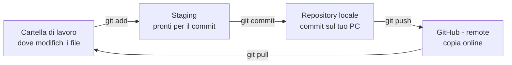

# Guida Git da Zero

## 1. Cos'è Git

Git salva la storia del tuo progetto: ogni volta che fai un **commit** scatti una "foto" dei file, e puoi sempre tornare indietro.

- **Git** = il programma che gira sul tuo computer.
- **GitHub** = un sito che ospita i tuoi progetti Git online (backup + condivisione).
- **Repository (repo)** = la cartella del progetto controllata da Git.
- **Commit** = una foto salvata dei file, con un messaggio che spiega cosa hai cambiato.
- **Remote** = la copia del repo che sta su GitHub.

I file passano da tre zone: la **cartella di lavoro** (dove modifichi), l'**area di staging** (dove prepari cosa salvare) e il **repository** (dove i commit restano salvati).



Tre comandi spingono i file verso GitHub; `git pull` li riporta indietro sul tuo computer.

## 2. Installazione

- **Windows**: scarica l'installer da [git-scm.com](https://git-scm.com) e lascia le opzioni predefinite. Usa poi il programma **Git Bash**.
- **macOS**: apri il Terminale e scrivi `git --version`. Se Git manca, il Mac ti propone di installarlo.
- **Linux (Ubuntu/Debian)**: `sudo apt install git`

Controlla che funzioni:

```bash
git --version
```

Se vedi un numero di versione (es. `git version 2.x.x`), sei pronto.

## 3. Configurazione iniziale (una volta sola)

Di' a Git chi sei: nome ed email finiscono dentro ogni commit. Usa la stessa email del tuo account GitHub.

```bash
git config --global user.name "Mario Rossi"
git config --global user.email "mario.rossi@email.it"
git config --global init.defaultBranch main
```

L'ultima riga fa chiamare `main` il ramo principale dei nuovi progetti, come su GitHub.

Controlla le impostazioni:

```bash
git config --list
```

## 4. Creare un repository

Hai due strade.

**A) Parti da una cartella tua**

```bash
mkdir mio-progetto
cd mio-progetto
git init
```

`git init` crea una cartella nascosta `.git`: è lì che Git salva la storia. Non toccarla.

**B) Scarichi un progetto già esistente su GitHub**

```bash
git clone https://github.com/utente/progetto.git
cd progetto
```

`git clone` scarica tutto il progetto con la sua storia, già collegato a GitHub.

## 5. Il ciclo base: modifica → add → commit

Questo è il ciclo che ripeterai sempre.

1. **Guarda la situazione**: quali file sono cambiati?
    ```bash
    git status
    ```
2. **Prepara i file** da salvare (staging):
    ```bash
    git add index.html     # un solo file
    git add .              # tutti i file cambiati
    ```
3. **Salva** con un messaggio chiaro:
    ```bash
    git commit -m "Aggiunta pagina iniziale"
    ```
4. **Guarda la storia** dei commit:
    ```bash
    git log --oneline
    ```

Consiglio: fai commit piccoli e frequenti, con messaggi che dicono *cosa* hai fatto ("Corretto errore nel login", non "modifiche").

**Esempio completo**

```bash
mkdir sito
cd sito
git init
echo "<h1>Ciao</h1>" > index.html
git status
git add index.html
git commit -m "Primo commit"
git log --oneline
```

## 6. Collegare GitHub: push e pull

**Prima volta (repo creato con `git init`)**

1. Su [github.com](https://github.com) clicca **New repository**, dai un nome e crealo **vuoto** (senza README).
2. Collega il tuo repo locale a quello su GitHub:
    ```bash
    git remote add origin https://github.com/utente/sito.git
    ```
    `origin` è il nome che diamo al remote.
3. Invia i commit (la prima volta con `-u`):
    ```bash
    git push -u origin main
    ```

**Le volte successive**

```bash
git push     # invia i tuoi commit su GitHub
git pull     # scarica le modifiche fatte da altri (o da un altro PC)
```

Regola d'oro: **fai `git pull` prima di iniziare a lavorare**, così parti sempre dalla versione più recente.

**Password**: GitHub non accetta più la password dell'account dal terminale. Quando Git chiede la password, incolla un **token**: su GitHub vai in *Settings → Developer settings → Personal access tokens*, creane uno e conservalo.

## 7. Branch (rami)

Un branch è una copia parallela del progetto: provi una modifica senza rovinare `main`.

```bash
git branch                  # elenca i branch (* = quello attuale)
git branch nuova-pagina     # crea un branch
git switch nuova-pagina     # spostati sul branch
# ...modifica, add, commit...
git switch main             # torna su main
git merge nuova-pagina      # unisci le modifiche in main
```

Su versioni vecchie di Git, al posto di `git switch` si usa `git checkout`.

## 8. .gitignore ed errori comuni

**.gitignore**: un file di testo nella cartella del progetto con l'elenco dei file che Git deve ignorare (password, file temporanei, librerie scaricate).

```
node_modules/
.env
*.log
.DS_Store
```

**Errori frequenti**

| Messaggio / problema | Cosa fare |
| --- | --- |
| `fatal: not a git repository` | Non sei nella cartella del progetto: usa `cd` oppure `git init` |
| `nothing to commit` | Non hai modificato nulla, oppure hai già fatto commit |
| `rejected ... fetch first` durante il push | Su GitHub ci sono modifiche nuove: fai `git pull`, poi `git push` |
| `Authentication failed` | Usa il token al posto della password (sezione 6) |
| Il commit si apre in un editor strano (Vim) | Hai dimenticato `-m`: scrivi `:q!` + Invio e riprova con `git commit -m "..."` |
| Ho fatto `git add` di un file per sbaglio | `git restore --staged nomefile` |

## 9. Riepilogo comandi

| Comando | A cosa serve |
| --- | --- |
| `git config --global user.name "Nome"` | Imposta il tuo nome |
| `git config --global user.email "email"` | Imposta la tua email |
| `git init` | Crea un nuovo repo nella cartella |
| `git clone URL` | Scarica un repo da GitHub |
| `git status` | Mostra i file cambiati |
| `git add .` | Prepara tutti i file per il commit |
| `git commit -m "messaggio"` | Salva una foto dei file |
| `git log --oneline` | Mostra la storia dei commit |
| `git remote add origin URL` | Collega il repo a GitHub |
| `git push -u origin main` | Primo invio su GitHub |
| `git push` | Invia i commit su GitHub |
| `git pull` | Scarica le novità da GitHub |
| `git branch nome` | Crea un branch |
| `git switch nome` | Cambia branch |
| `git merge nome` | Unisce un branch in quello attuale |